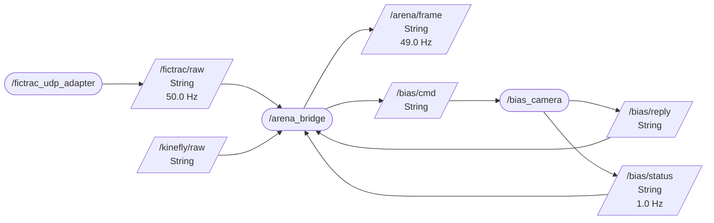

# LAB-303 Plan B — Windows results, reiserlab-ww18, 2026-10-15

First Windows run of `ros2-poc/WINDOWS-TEST.md`. **Status: every step except the typed build passed on
ww18** — 0–3, 6 and 5b unattended (harness 45/45, now 47/47, after the fixes below), then with Michael at
the rig: **4** (BIAS through the node on the Atlas10 camera, incl. the unknown-outcome path), **5** (Studio +
G6 2×10 controller + real FicTrac at 96 Hz + BIAS, idx mismatch 0.00 % in both epochs), **5.7** (bridge
hard-killed mid-loop: every frame recovered from the bag), a **10-min soak** (0.00 % / 0.00 %, BIAS lost 0 of
81 567 frames) and **5c** smoke on the four-color arena (8/8 trials pass, CW then CCW confirmed). **Step 1b /
7 (typed messages)** was blocked by a pixi-build-ros packaging bug after two Windows hurdles were cleared
(W2). **Follow-up the same day:** a package-level workaround installs the typed env (35 s, harness 48 / 48),
and a prebuilt-channel install needs no compiler at all (9 s, 48 / 48) — `docs/typed-windows.md`.

## Machine

| | |
|---|---|
| Host | REISERLAB-WW18, Windows 11 Enterprise 10.0.26200 x64, 1.76 TB free on C:, 1.86 TB on D: |
| git / pixi / gh | 2.55.0.windows.3 / **0.80.0** / 2.101.0 (all already installed; nothing to install) |
| Chrome | 155.0.8059.79 |
| MSVC | **Visual Studio Build Tools 2026** 18.9.2 (MSVC 14.51.36231, Windows SDK 10.0.26100.0). **No VS 2022.** |
| BIAS | NOT the FLIR/Spinnaker build: `C:\Lab\GitHub\atlas-bench-rob23\bias\build_ucrt\test_gui.exe` (built 2026-10-15 10:50), the atlas-bench Atlas10 fork (LUCID Arena backend, MinGW/UCRT64), launched by `BIAS Atlas10.bat`, recordings default `D:\rec\<user>` |
| Checkout | `C:\Users\reiserm\Documents\GitHub\webDisplayTools`, branch `claude/ros-studio-plan-b-c44942` from 06bafb8 |

## Findings (Windows-specific unless marked)

| # | Step | Finding | Status |
|---|---|---|---|
| W1 | 1a / 2 | `$PIXI_PROJECT_ROOT` stays literal in `[activation.env]` on Windows; `pixi run router` then exits: `zenohc::config: Failed to read config from $PIXI_PROJECT_ROOT/config/zenoh-router.json5: The system cannot find the path specified. (os error 3)` (no fallback to the stock config). `%PIXI_PROJECT_ROOT%` does expand under `pixi run`. | **fixed** bd2e349 (`[target.win-64.activation.env]`) |
| W2 | 1b | The typed build fails with **VS Build Tools 2026 only**: `Could not find the compiler specified in the environment variable CC: cl.exe.` conda-forge `vs2022_win-64` (19.44.35207) looks for VS `[17,18)`, then the v143/14.44 components, then hard-coded `…\2022\…` paths, then `vswhere -latest` **without `-products *`**, which never lists a Build-Tools-only install. Then, with the v143 group added (below): (2) **MAX_PATH** — `fatal error C1083: Cannot open compiler generated file: '': Invalid argument` on a 265-char object path under `C:\Users\reiserm\Documents\GitHub\webDisplayTools\ros2-poc\.pixi\bld\arena_interfaces\…\work\build\CMakeFiles\…\_arena_interfaces_s.ep.rosidl_typesupport_fastrtps_c.c.obj` (`LongPathsEnabled` 0); the build adds ~215 chars, so the checkout path must stay under ~45; (3) at `C:\w` it compiles and links (156 files, 16 s), then packaging fails: `× paths in archives must not have '..' when setting path for Library` — the package lists `Library/../Lib/site-packages/arena_interfaces/…` (RoboStack's Windows `PYTHON_INSTALL_DIR=../Lib/site-packages`). | (1) fixed on the PC: `Microsoft.VisualStudio.ComponentGroup.VC.Tools.143.x86.x64` added to VS 2026 Build Tools (UAC, < 5 min; the script's 3rd vswhere query finds it); (2) short checkout path, or `detached-environments` ≤ 12 chars (works from a 79-char checkout); (3) **worked around** 538cc85 (normalized `PYTHON_INSTALL_DIR` in the package's CMakeLists.txt). Cause: pixi#6691 appends CMake's `install_manifest.txt` to `RATTLER_BUILD_PACKAGE_FILES`, which rattler-build never normalizes. Upstream fix prefix-dev/pixi#7226 open, not merged. Prebuilt-channel route tested. Details + upstream reports (rattler-build#2875, comment on pixi#7226): `docs/typed-windows.md` |
| W3 | 3 | Text-mode writes are CRLF on Windows: `mcap_convert --out`, `export_log`, the emulator's export copy → 2 byte-identity FAILs against bridge 3.4's binary `--convert`. | **fixed** aeccdce (`newline="\n"`) |
| W4 | 3 / 5.6 | bridge 3.4's own live file is CRLF on Windows (`fictrac-bridge/bridge.py:711`, text-mode `open(…, "a")`); its export re-reads in text mode and gzips binary, so committed logs are LF. The PoC's shadow file inherits this, so step 5.6's `fc.exe /b export shadow` will differ on **every line** here; compare with `splitlines`, not bytes. | not fixed (bridge 3.4 untouched) |
| W5 | 3 | JS reader check skipped: `find_node()` looked for `.pixi\envs\default\bin\node.exe`; conda's Windows layout has `node.exe` at the env root (and a fresh clone needs the root `pixi install`, 5.3 s / 0.30 GB). | **fixed** aeccdce |
| W6 | 6 | **Ctrl-C on `pixi run rig` killed the bridge node instead of stopping it**: no `shutting down` line, shadow file ended on a FicTrac row (no `logging_stopped`), the open run's bag got **no `metadata.yaml`** (649 KB unindexed). `CTRL_BREAK_EVENT` (rig.py / harness stop signal) ends a Python process at once by default, and `loop.add_signal_handler` is not implemented on Windows. | **fixed** 4935732 (SIGBREAK handler) — after: `[bridge-node] shutting down`, `[record] closed … 973 records, 95255 B`, `metadata.yaml` written, nothing lingers |
| W7 | 6 | Second `pixi run rig`: the refusal listed 8765 + 60000 but **not 7447** with a router listening. `port_in_use()` sets `SO_REUSEADDR`, which on Windows lets the probe bind over a live listener (zenohd; asyncio's socket is exclusive, so 8765 was caught). | **fixed** 4935732 (plain bind on Windows; TIME_WAIT does not block it — checked) |
| W8 | 4 | **Two programs can hold port 5010 at once**: real BIAS on `0.0.0.0:5010` + `[::]:5010`, and a harness `bias_sim` on `127.0.0.1:5010`; loopback clients get the more specific socket, i.e. the SIM. Seen by accident (a probe answered by the sim). On Windows Qt's listener shares its address, so NO bind probe sees it — plain, wildcard and `SO_EXCLUSIVEADDRUSE` binds of 5010 all succeeded next to BIAS; only a connect does. | **fixed** cbd0d31 — bias_sim refuses when its port answers, binds exclusively on Windows, reports `"sim": true`; rig.py confirms a "free" TCP port with a connect on Windows; the harness uses a free port for its sim |
| W9 | all | `time.monotonic()` = `GetTickCount64`, resolution **15.625 ms** (Python 3.12.15); every `rtt_ms` the BIAS node reports is quantized (0 / 15 / 16 / 31 ms seen). `time.time()` (all run-log `ms`, bridge 3.4 too) reports the same nominal resolution; today's logs were fine (FicTrac row deltas 19/20/21 ms) because something on the PC raised the timer rate — a rig where nothing does would log 15.6 ms steps. | **fixed** cc603f6 for durations (`perf_counter`: BIAS RTTs, bag open / convert / reindex times), and for stamps by the "Windows clocks" commit (precise wall clock, perf-counter latency, 1 ms timer — trade-offs below) |
| X1 | 3 | (cross-platform) converter put a device row recorded in the same ms as `logging_stopped` AFTER it (`live 2238 vs conv 2239`). | **fixed** 6250cdb, revised in 667e538: such a line is moved before the stop (`moved_before_stop`), since after X2 every derived record precedes it |
| X2 | 3 | (cross-platform) the mirror race at run START: the ROS thread recorded device messages on arrival (`_kinefly` → `rec.write_raw`, dropped while `self.rec` is None) while the live line is written later on the asyncio loop, which is busy in `_open` — so the shadow file could hold a device row the bag never saw (`live 2237 vs conv 2236`, `["kf",2,162,…]`; 1 run in 4). Same mechanism for FicTrac: `FAIL bag → full level: one fictrac_frame per frame with the 25 FicTrac columns … — 922 frames vs 922; cols [0, 25]` (the run's first frame recorded, its `/fictrac/raw` message not; 1 run in 5). | **fixed** 667e538 — Kinefly, BIAS reply/status and FicTrac messages are recorded on the loop next to their line, under the shadow writer's open gate (`record_device`), with the ROS receive time kept as the MCAP log_time; FicTrac after `handle_line`, off the closed-loop path. **5 runs in a row 45 / 45**, derived counts equal every run |
| B1 | 4 probe | This BIAS's `set-video-file` uses `baseName()` and the logging format's extension: `poc.avi` → `poc.ufmf`; `my trial.v2.avi` → `my trial.ufmf` (silently truncated at the first dot). | info for bias_node / protocol authors |
| B2 | 4 | **Confirmed**: artifact `D:/rec/reiserm/ros2-poc/poc.ufmf`, file written `poc_cam_0_date_2026_10_15_time_13_43_10_v001.ufmf`; and the per-frame timestamps live only in `stamp_log_cam0.txt`, which BIAS **overwrites on every recording**. | **fixed** 2584e03 — stopRecording resolves the file BIAS wrote (`resolved`, `bytes`), reads the stamp log and publishes every frame's timestamp on `/bias/frames` (recorded in the bag); status poll 1 → 5 Hz. Real BIAS: 1 087 frames = 1 087 lines on disk = 1 087 timestamps in the bag |
| B3 | 4 | Atlas10 `connect` takes **2.18 s**, past the node's 2 s per-call timeout: a successful connect came back `outcome: "unknown"` (exit 3). `stop-capture` takes 0.26 s on 30 s recordings but **~3.2 s on 8 s ones** (BIAS's first uFMF background update; up to ~6.5 s possible). A/B: 5 Hz polling has no effect. | **fixed** 5b0fcfb — `--slow-timeout-s` 15 for connect/disconnect/load-configuration/start-/stop-capture/close |
| B4 | 4 | Windows: a connect to a **closed** localhost port is refused only after **~2.05 s** (`WinError 10061` after 2048 ms; macOS refuses at once). With BIAS gone, every command waits its timeout and reads `unknown` (4.0 s for getTimestamp), never a hang. | info (could cap the connect step separately) |
| W10 | 5 | `rig.py --bias-args "--video-dir D:\rec\reiserm\ros2-poc"` (WINDOWS-TEST's own form): POSIX `shlex` ate the backslashes → `"filename":"D:recreisermros2-poc\\poc_studio_run.avi"`, video in `D:\recreisermros2-poc\`. | **fixed** a0634f1 (`split_args`, all `--x-args`) |
| W11 | 5 | `fictrac.exe` run directly exits `0xC0000135` (STATUS_DLL_NOT_FOUND, no output, no log): this FicTrac is pixi-built; `build\Release\fictrac.bat` puts its env + Spinnaker on PATH. | info for WINDOWS-TEST.md |
| H1 | 5 | The soak controller's SD card was **not mounted** (GET_SD_INFO status 1, 0 sectors, 0 files) — the Studio only said the pattern was missing. A new 64 GB SanDisk card (**exFAT**, 128 KiB clusters) mounted at once; 8 patterns uploaded in ~0.5 s each (up to 14 MB/s). In the 10-min soak one burst of **8 slow reads (20–41 ms) in ~80 ms** flagged a trial (`display_gap` sd_slow + frame_age); trial 2's 23 217 reads max 0.5 ms. | open: characterize exFAT/64 GB with `sd_stall_test.py`; ≤ 32 GB FAT32 until then |
| S1 | 5.7 | Bridge hard-killed mid closed loop: the Studio showed only "bridge disconnected" — **no banner, the run carried on**, and BIAS was never stopped (stopRecording goes through the bridge). The rig stopped all its children as designed. | open (Studio/runner: bridge loss in a closed-loop or connector step should banner and end the run — LAB-303 `critical`/`on_loss`) |
| S2 | 5 | A Studio tab opened at `?p=bias_camera_closed_loop_poc_ww18_soak10` did not load the protocol until it was refreshed (server, index entry, file and parse all verified fine). | open (to reproduce) |

Harmless on every process: two zenohc WARNs (`` `routing.router.peers_failover_brokering` is deprecated `` and
`` routing.peer.mode` and `routing.peer.linkstate` are deprecated ``) — our config files carry stock keys this zenohc ignores.

Info, not a check: the harness's `derived_misplaced` (a derived line after a different neighbour than in the
live file) ranged 4–861 of ~2240. It tracks how many Kinefly rows share a millisecond with a FicTrac row, which is
the converter's unbreakable tie: 40 % in the 861 run, 0–2 % in the others. On Windows the 10 ms and 20 ms senders
can wake on the same timer tick.

### Windows clocks — what changed and the trade-offs (for review)

Measured on ww18 with nothing raising the timer (`NtQueryTimerResolution` current = 15.625 ms):

| clock | step as found | after `timeBeginPeriod(1)` |
|---|---|---|
| `time.time()` (bridge 3.4's `now_ms()`, every run-log `ms`) | ~15.6 ms, 2.3 ms behind true time | 1 ms |
| `GetSystemTimePreciseAsFileTime` | **1 µs** | 1 µs |
| `time.monotonic()` | 15–16 ms | 15–16 ms (unaffected) |
| `time.perf_counter()` | < 1 µs | < 1 µs |

The PoC now uses, on Windows only (`_common.py`; macOS/Linux unchanged):

1. **Precise wall clock for every stamp** (`wall_ns` / `wall_ms` = `GetSystemTimePreciseAsFileTime`, what
   Python 3.13 made `time.time()`; RoboStack Jazzy pins 3.12): the bridge node rebinds bridge 3.4's module
   `now_ms` in its own process (the file is unchanged), plus the recorder's `log_time`, the adapters'
   `rx_epoch_ms` and the BIAS node's stamps. Cost 0.42 µs per call (ctypes) at a few hundred stamps/s — nothing.
   Trade-off: none found. It is still wall-clock time, so a clock correction (NTP/w32time) moves it exactly as before.
2. **The perf counter for cross-process latency** (`mono_ns` = `perf_counter_ns`, adapter `rx_mono_ns` vs the
   bridge's): one system-wide counter (4 processes agreed within 3.3 µs). `connector_status` FicTrac latency is
   now exact — p50 0.27–0.30 ms, p99 0.55–0.65 ms — instead of carrying the 0–1 ms floor of whole-ms stamps.
   Trade-off: only valid with adapter and bridge on ONE host (always true for this loopback-only graph) and the
   same code; out-of-range values fall back to the wall-clock difference. BIAS envelopes have no counter stamp yet.
3. **A 1 ms system timer** (`timeBeginPeriod(1)` in the bridge node, both adapters and the BIAS node, plus the
   Windows 11 opt-out so a minimized console keeps it). Trade-offs: (a) the timer interrupt runs at 1 kHz while
   any of these processes is up, which costs power — irrelevant on a mains-powered rig PC, a battery cost on a
   laptop; (b) it does NOT sharpen the closed loop, which is event-driven (UDP → ROS → loop wake-ups) — it sharpens
   waits and timeouts (asyncio, socket, rcl) and incidentally `time.time()` in every process on the PC (so
   bridge 3.4 too while the graph runs). Harness frame lag p99 1.02–1.05 ms over 5 runs (1.0–1.9 ms before) —
   possibly this, possibly noise. **Easy to drop** if you prefer: one call per process.

Not covered: **bridge 3.4 itself** (Production) still stamps with `time.time()`, so on an idle Windows rig PC its
run logs are 15.6 ms-quantized unless something else (often Chrome) holds a fast timer. Same two-line fix, but it
ships through a release PR.

### Why the Mac runs did not show these

- **Windows-only by construction** (W1–W7, W9): pixi activates through cmd.exe (no `$VAR`); MSVC must be on the
  machine, where the Mac gets clang from conda-forge; text mode writes CRLF; conda's Windows env puts `node.exe` at
  the root; Windows cannot send SIGINT to another process, CTRL_BREAK kills Python by default and asyncio has no
  signal handlers there; `SO_REUSEADDR` means "bind over a live listener"; `monotonic` ticks at 15.6 ms. The
  harness could not catch W6 on either platform: it closes runs with `log_export` before stopping anything.
- **Races on both platforms, likelier here** (X1, X2): one message has to land in the few ms the loop spends opening
  or closing a run. Here the bag open alone takes ~15 ms (new files in `%TEMP%`, NTFS + Defender), and the
  tick-driven senders deliver in bunches. On the Mac the same race could have hit rarely without being seen.
- **A different BIAS** (B1, B2): the Mac used the Mac BIAS port (`movie.mjpg`); ww18 runs the atlas-bench Atlas10
  fork (uFMF, server on by default, extra status keys). W8 also needs the real BIAS open while the harness runs,
  which the Mac bench never combined (whether macOS would let the sim bind next to BIAS was not checked).

## Step log (times ET)

| # | Time | Step | Result | Timing / size | Notes, errors verbatim |
|---|---|---|---|---|---|
| 0.1 | 10:57 | tooling check | PASS | — | git 2.55.0.windows.3, pixi 0.80.0, gh 2.101.0 (logged in, https), Chrome 155.0.8059.79; `vswhere -version "[17.0,18.0)"` → nothing; VS Build Tools 2026 18.9.2 with `VC.Tools.x86.x64` |
| 0.2 | 10:58 | install missing tooling | skipped | — | nothing missing; VS 2022 decision deferred to after 1b |
| 0.3 | 10:58 | clone (HTTPS) + `git switch` | PASS | 1.9 s + 0.4 s; 54.5 MB with .git | — |
| 0.4 | 10:58 | bridge 3.4 / ports | PASS | — | no bridge running; `netstat … ":7447 :8765 :8092 :60000 :60001 :5010"` empty |
| 1a | 10:59 | `pixi install --locked` | **PASS** | **25.1 s**; env 1.45 GB / 37 984 files | ROS part cold (0 ros-jazzy pkgs cached; cache 7.99 → 8.94 GB); nothing by hand; Python 3.12.15 |
| 1a.2 | 11:00 | `$PIXI_PROJECT_ROOT` check | **literal** | — | `ROUTER= $PIXI_PROJECT_ROOT/config/zenoh-router.json5`, exists False (W1) |
| 1b | 11:00 | `pixi install --locked -e typed` | **FAIL** | 26.9 s to failure | `CMake Error at %BUILD_PREFIX%/Library/share/cmake-4.4/Modules/CMakeDetermineCCompiler.cmake:48 (message): Could not find the compiler specified in the environment variable CC: cl.exe.` → `Error: × failed to build 'arena_interfaces' from 'interfaces/arena_interfaces' ╰─▶ × Script failed to execute` (W2). ~5 min spent; continued with the default env |
| 1a.3 | 11:03 | fix W1 | PASS | `--locked` 4.3 s, lock unchanged | `ROUTER= C:\Users\reiserm\Documents\GitHub\webDisplayTools\ros2-poc\config\zenoh-router.json5 True`, SESSION True |
| 2.0 | 11:02 | `pixi run router` before fix | FAIL | — | `ERROR ThreadId(01) zenohc::config: Failed to read config from $PIXI_PROJECT_ROOT/config/zenoh-router.json5: The system cannot find the path specified. (os error 3) at D:\bld\libzenohc_1777492468845\…\zenoh-config\src\lib.rs:1378.` / `logging system isn't initialized: call to rcutils_logging_console_output_handler failed.` / `[ros2run]: Process exited with failure 1` |
| 2.1 | 11:04 | router / listener / talker | **PASS** | latency 39.2 ms (msg 0), then 1.8–2.6 ms | `Zenoh can be reached at: tcp/127.0.0.1:7447`; 14/14 heard |
| 2.2 | 11:05 | Ctrl-C all three | PASS | — | talker: expected `RCLError: failed to shutdown: rcl_shutdown already called on the given context`; **router does not linger** (`tasklist \| findstr rmw_zenohd` empty) |
| 3.1 | 11:05 | `pixi run test -- --keep`, as shipped | **FAIL 41 / 44** | 57.9 s | FAIL `conversion fidelity: derived lines … — live 2238 vs conv 2239, Δms {}` (X1); FAIL `bridge.py --convert v2→v1→v2 byte-identical` and `bag → behavior_v1 == bridge.py --convert of the behavior_v2 (byte-identical)` (W3); skip `JS reader check: no \`node\` and no root pixi env` (W5). Bag 4852 records / 342 809 B |
| 3.2 | 11:11 | run 2, after aeccdce + 6250cdb | **PASS 45 / 45** | 58.4 s | JS readers PASS; derived Δms p50 0 / p99 1 / max 7 (n 2241); frame lag p50 0.569 / p99 0.951 / max 1.806 ms; bag 4858 records / 339 241 B. (Mac 46 = + the typed-import check) |
| 3.3 | 11:13 | run 3 | **FAIL 44 / 45** | 58.1 s | `live 2237 vs conv 2236` — start race (X2); the stop tie also recurred and was dropped (`dropped_after_stop: 1`) |
| 3.4 | 11:21 | run 4, after 4935732 | **PASS 45 / 45** | 58.9 s | derived 2243 == 2243, Δms p99 1 / max 7 |
| 3.5x | 11:50 | 5 runs after the first X2 fix (Kinefly + BIAS on the loop) | 4 × 45/45, 1 × 44/45 | 53–58 s each | derived counts equal in all 5; run 5: `bag → full level … cols [0, 25]` → the same race on `/fictrac/raw` (X2) |
| 3.7x | 13:26 | 5 runs, precise clocks + 1 ms timer | **5 × PASS 45 / 45** | 52.4–58.2 s | frame lag p99 1.044 / 1.052 / 1.052 / 1.024 / 1.051 ms; bridge log `Windows clocks: precise wall clock for every stamp; 1 ms system timer granted` |
| 3.8x | 13:35 | 3 runs, + perf-counter latency | **3 × PASS 45 / 45** | 53.2–58.8 s | `connector_status` fictrac lat p50 0.27 / 0.30 / 0.27, p99 0.55 / 6.92 / 0.65 ms (6.92: the run with the adapter-kill window); kinefly p50 0.29–0.33 |
| 3.6x | 11:56 | **5 runs in a row, final X2 + W8 + W9** | **5 × PASS 45 / 45** | 53.3–58.1 s each | derived 2243/2240/2248/2242/2246, equal live vs conv every run; Δms p99 1 / max 2–8; frame lag p99 1.00 / 1.67 / 1.55 / 1.89 / 1.51 ms; harness sim on a free port (BIAS open on 5010 throughout); no permission errors |
| 3.5 | — | crash phase (run 2) | PASS | — | crashsafe: NDJSON 616 lines / 157 frames (last 3117 ms) vs bag `--recover` 611 lines / 156 frames (last 3097 ms), torn: true → **1 frame lost** (Mac: 1). default: NDJSON 157 frames; bag `.mcap` 0 B, `[convert] ValueError: no session-open record on /arena/session (not a bridge-node bag, or the open record was lost)`. `info typed topics: False`. Process groups, CTRL_BREAK, TerminateProcess, concurrent file reads, PYTHONUTF8, MCAP under a Windows path: all fine |
| 6.1 | 11:17 | second `pixi run rig` | PASS* | — | one clear `[rig] cannot start, ports already bound:` + `tcp 127.0.0.1:8765 …` + `udp 127.0.0.1:60000 …`, no traceback; *7447 missing (W7). After the fix, all three listed |
| 6.2 | 11:18 | Ctrl-C the rig with a run open | **FAIL** → fixed | — | every child exited, nothing lingered, but no `metadata.yaml`, shadow file without `logging_stopped` (W6). After 4935732: PASS (`metadata.yaml` 2639 B, bag reindexed 649 → 95 KB) |
| 6.3 | 11:20 | `pixi run rig` while bridge 3.4 runs | **PASS** | — | same refusal naming `bridge 3.4 (\`pixi run bridge\` at the repo root)` for 8765 and 60000 |
| 5b | 11:24 | `pixi run graph -- --text` / `--out` | **PASS** | 9.6 s | rig `--sim --bias`: nodes `/arena_bridge, /bias_camera, /fictrac_udp_adapter`; `/arena/frame` 50 Hz, `/fictrac/raw` 50 Hz, `/bias/status` 1 Hz, `/bias/cmd` + `/bias/reply` wired. Mermaid below. viz env not installed (optional) |
| 4p | 11:22 | BIAS HTTP probe (no camera commands) | **PASS** | RTT 15–32 ms | see "BIAS probe" |

### BIAS probe (the four questions; BIAS launched with `BIAS Atlas10.bat`, camera NOT connected)

1. **Server enabled?** Yes, by default (`DEFAULT_HTTP_SERVER_ENABLED = true` in this build): no menu click needed.
2. **Port?** **5010** (= 5000 + 10·(camera 0 + 1)); it listens on `0.0.0.0:5010` and `[::]:5010` (all interfaces).
3. **`?get-status` shape:** the Mac keys (`connected, capturing, logging, frameCount, framesPerSec, timeStamp`)
   **plus** `cameraSkipped, delivered, frameIdGaps, incompleteFrames, inputBuffers, inputBuffersMin, lastFrameId,
   logQueueSize, loggerSkipped, nominalPeriodMs, streamStatsValid, timeouts, writerSkipped` (and, once streaming,
   the camera-health keys from ATLAS10.md); no `videoFile` key. The node passes them through to `/bias/status` unchanged.
   ```
   [ { "command" : "get-status", "message" : "", "success" : true, "value" : { "cameraSkipped" : 0, "capturing" : false, "connected" : false, "delivered" : 0, "frameCount" : 0, "frameIdGaps" : 0, "framesPerSec" : 0.0, "incompleteFrames" : 0, "inputBuffers" : -1, "inputBuffersMin" : -1, "lastFrameId" : 0, "logQueueSize" : 0, "loggerSkipped" : 0, "logging" : false, "nominalPeriodMs" : 0.0, "streamStatsValid" : false, "timeStamp" : 0.0, "timeouts" : 0, "writerSkipped" : 0 } } ]
   ```
4. **`get-video-file` after `set-video-file`** (sent with bias_node's exact encoding, backslashes raw):
   `D:\rec\reiserm\ros2-poc\poc.avi` → `D:/rec/reiserm/ros2-poc/poc.ufmf` (dir created); forward slashes work too;
   `my trial.v2.avi` → `D:/rec/reiserm/ros2-poc/my trial.ufmf`; `relname.avi` → `C:/Lab/GitHub/atlas-bench-rob23/bias/relname.ufmf`.
   Initial value `D:/rec/reiserm/bias_video.ufmf` (restored afterwards). Format = **ufmf** (this build's start-up
   default). `get-camera-guid` → `169.254.22.96`; `get-configuration` → `Unable to get configuration: camera is not connected`.

**Does `bias_node.py` need a change?** Not to work: every reply parses, Windows paths survive the URL, extra
status keys pass through. Two things to settle in step 4: B2 (the `artifact.path` vs the auto-named file), and
whether to send `.ufmf` names (the protocol's `.avi` is replaced anyway).

### Graph (step 5b, rig `--sim --bias`)



## Hardware steps (afternoon, Michael at the rig; times ET)

Rig: CSHL G6 2×10 ball arena, controller COM4 (fw `12bba7e9` 2x10 2026-09-30), real FicTrac
(`cshl\rig05_vfov28_2026-09-22\config.txt` via `fictrac.bat`, 96–97 fps), BIAS Atlas10 (ATX081S-M,
2840×2840 Mono8, 135.6 fps, uFMF). Studio = this branch served from the checkout (`localhost:8092`), Chrome 155
(no local-network-access prompt).

| # | Time | Step | Result | Numbers / notes |
|---|---|---|---|---|
| 1b′ | 13:40 | MSVC v143 group into VS 2026 Build Tools | done | installer launched 13:40:29, installed < 5 min; `VC\Tools\MSVC\14.44.35207` next to 14.51 |
| 1b″ | 13:44 | `pixi install -e typed` (Documents path) | FAIL | MSVC found now; `C1083` MAX_PATH (W2-2) |
| 1b‴ | 14:26 | same at short path `C:\w` (detached worktree) | FAIL | compiles + links in 16 s; packaging `..` error (W2-3). Time-box reached |
| 4.1 | 13:41 | `bias-cmd connect` (2 s timeout) | unknown → B3 | `timeout after 2.0s`, `outcome: "unknown"`, exit 3 — while `get-status` said `connected: true` |
| 4.2 | 13:43 | connect / startRecording `poc.avi` / getTimestamp / stopRecording (15 s slow timeout) | **PASS** | 2178 / 140 (set-video-file 11, enable-logging 2, start-capture 116, get-video-file 11) / 11 / 263 ms; 2075 frames in 15.3 s, 0 gaps, 0 camera/writer/logger skips, 50.8 °C; file `poc_cam_0_…_v001.ufmf` (B2) |
| 4.3 | 13:44 | unknown-outcome path (BIAS closed mid-recording) | **PASS** | `/bias/status` `reachable:false` (`<urlopen error timed out>`), `getTimestamp` `outcome:"unknown"` exit 3 in 4.0 s, no hang; BIAS restarted → `reachable:true` without restarting the node. The open uFMF has no index (BIAS limit) |
| 5.1 | 15:06 | Studio run, Mac-bench protocol | partial | camera bracket ok (connect 2196 ms), `trialParams` status 1 → runner refused the loop (`unknown frame count for pattern idx 1`) — no pattern on the card (H1); video misplaced (W10); fidelity exact over 10 868 lines; 0 epochs |
| 5.2 | 15:25 | Studio run, `bias_camera_closed_loop_poc_ww18` (`grating_sq`, slot 2) | **PASS** | 2 epochs, idx mismatch **0.00 % / 0.00 %**, frames 20 (from the card); `cc_0x70_ok` 2893; fidelity: 18 476 lines, 109 derived ±1 ms; 6 camera replies ok via ws; bag 3.1 MiB / 23 828 msgs, all topics; video `poc_studio_run_…_15_25_01_v001.ufmf` 16.3 MB in `D:\rec\reiserm\ros2-poc`; 1 trial "unknown" = pre-run Console test (`coverage: controller_reboot`) |
| 5.7 | 15:35 | crash: `taskkill /F` the bridge 10.4 s into the first loop | **PASS** (+ S1) | rig stopped all children; bag without metadata.yaml (1.31 MB); `--recover`: **1162 frames, last 12 046 ms — identical to the shadow NDJSON** (only the final arena echo line missing; the Mac lost 1 frame); recover 5.4 s |
| soak | 15:44 | `…_ww18_soak10` (2 × 300 s closed loop) | **PASS** (+ H1) | idx mismatch **0.00 % / 0.00 %**; 221 926 lines, fidelity exact (618 derived, ±6 ms max); 58 918 FicTrac rows (Δ 9–12 ms, no 15.6 ms steps); `cc_0x70_ok` 57 811; adapter→bridge p50 0.55 / p99 1.26 ms; BIAS 81 567 frames at 135.59 fps, 0 gaps / skips / incomplete / timeouts, buffers ≥ 123/128, 0 TCP retransmits; **uFMF 14.2 GB / 10 min ≈ 24 MB/s** (the fork's figure; ~85 GB/h); trial 3 flagged by one SD-stall burst (H1) |
| 5c | 15:56 | `g6_color_optomotor_smoke` on the four-color arena (COM7: fw `c15d840a` restack/panel-boot 2026-09-29, 8 GB FAT32, patterns already on the card) | **PASS** | `runlog-check` OK, **8/8 trials pass**; violet, blue, green, yellow each CW then CCW — direction confirmed by eye, no `fps_cw`/`fps_ccw` swap; 12 camera replies ok, BIAS clock +12.03 s per trial |
| W2-3 | 16:22 | typed build, packaging bug: baseline at `C:\w\t` (detached worktree) | FAIL (reproduced) | 32 s; 21 of 151 package-file entries `<host>/Library/../Lib/site-packages/…` |
| W2-3′ | 16:25 | + CMakeLists workaround (538cc85), `--locked`, clean `bld/` | **PASS** | 35 s (16 s build), 0 entries with `..`; `--check` importable + serializes; **harness 48 / 48** in 61 s, `typed topics: True` |
| W2-3″ | 16:28 | same from a 79-char checkout + `detached-environments = 'C:\w\px'` | **PASS** | 36 s; longest object path 253 chars |
| W2-5 | 16:32 | prebuilt: `pixi publish` → local file channel; `typed` from the channel, no path dep, no toolchain | **PASS** | publish 26 s (101 KiB `.conda`); fresh `--locked` install **9 s, no build backend started**; **harness 48 / 48** in 56 s (scratch manifest, not committed) |

## Still open

- **1b / 7** typed messages: installable now (W2-3′, W2-5). The decision is between building on each PC
  (MSVC v143 + `detached-environments`) and a CI-built channel (no compiler; workflow sketch in
  `docs/typed-windows.md` §5). Step 5 hardware runs were not repeated with `-e typed`. Upstream: filed 2026-10-16,
  prefix-dev/rattler-build#2875 + a confirming comment on prefix-dev/pixi#7226 (§4). **Next: run
  WINDOWS-TEST.md 7b on a PC without Visual Studio.** The `typed-prebuilt` env (2026-10-16, a ww18-built
  package committed in `channel/`) installs `--locked` in 5 s on ww18, harness 49 / 49.
  **Decided 2026-10-16 (`docs/typed-distribution-decision.md`): CI-built channel; workflow
  `.github/workflows/arena-interfaces.yml` added (build on PR, channel artifact, tag → hosted upload when configured).**
- **S1** bridge loss should banner and end the run; **S2** `?p=` needed a refresh; **H1** characterize the 64 GB
  exFAT card; **5c full** (18 min) and real-fly runs; **hardware sync** (camera strobe → controller Digital IO)
  for µs frame timing on the controller's clock.

## Artifacts on ww18 (not committed)

`%TEMP%\ros2-poc-test-id0n3u9y` (run 1, 41/44), `-12brtne7` (run 2), `-wzz38rvp` (run 3, X2), `-mm7i3ha1` (run 4),
`-yooxcvjy` (the FicTrac `cols [0, 25]` run), `-f8g23mlb` `-pxq2m1xb` `-qpd_gp_2` `-7n08p78f` `-03b6r1gt` (final 5);
`ros2-poc\runlogs\arena-log-20261015-111739-702.*` (W6 before the fix) and `…-111942-495.*` (after);
hardware runs `ros2-poc\runlogs\arena-log-20261015-150605-299.*` (5.1), `-152501-050.*` (5.2), `-153548-287.*`
(5.7 crash), `-154452-578.*` (soak), `-155617-614.*` (5c), `-160327-867.*` (B2 check), with exports in
`runlogs\exports\`; videos + stamp log in `D:\rec\reiserm\ros2-poc\` (the A/B `ab_*` and `b2test` recordings
are test files); controller probes in the session scratchpad.
